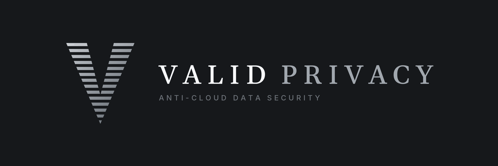

# Anti-cloud data security

Valid Privacy builds local-first, source-available systems in Rust and JavaScript: Valid Network, a Layer 1 blockchain, along with an encrypted password manager that is out now, an experimental radar gesture control system, and early peer-to-peer networking. Each one keeps data on the user's own device and works without a third-party server.

## Valid Network · Flagship

A Layer 1 blockchain written from scratch in Rust, with an original consensus mechanism, Three-Party Integrity (TPI). Three randomly selected validators produce each block, and validator standing is earned through block production. Chain state is held in memory, the node ships as a single binary with vendored dependencies, and peer transport runs over TLS 1.3 with hashed, epoch-salted peer identity. In testnet development at v0.8.0, to be stewarded by the Valid Foundation.

[Repository](https://github.com/validprivacy/valid-network) · [Whitepaper](https://validprivacy.github.io/network-whitepaper.html) · [Litepaper](https://validprivacy.github.io/network-litepaper.html)

## Valid Vault · Out now

A password manager for Chromium browsers and Android. The vault is encrypted on the device with AES-GCM under a single master key, wrapped separately for fingerprint, device PIN, and master password, with no stored password hash and no server. Vaults move between devices over a local QR stream or an encrypted backup file, and browsers on the same computer can share one encrypted vault file. Stores logins with their two-factor codes, personal info, crypto wallet seed phrases, and bookmarks. Includes the first mobile version of Valid Browser, a modified Chromium browser. At v0.9.4.4, with 174 automated tests run on every push.

[Repository](https://github.com/validprivacy/valid-vault) · [Chrome Web Store](https://chromewebstore.google.com/detail/valid-vault-password-mana/fkpfaemmphmakebhejhaegjgcnieeoab) · [User Guide](https://validprivacy.github.io/vault-guide.html)

## Valid Symphony · Experimental

Experimental work in short-range radar sensing as a human interface. A 60 GHz mmWave radar produces a 3D point cloud, which Symphony reduces to a tracked hand position inside a defined control volume. A clutch model separates deliberate input from incidental motion: control engages only when the hand holds still in the volume and releases when it leaves, so a person walking through the field produces no output. The tracked position maps to continuous control, with lighting as the first output.

The tracking core is written in `no_std` Rust so the same code runs on a host computer during development and on the radar chip's embedded processor in later hardware. The radar measures range and motion only, and all processing stays on the local network. Currently in prototype on Texas Instruments 60 GHz radar hardware, with zero third-party dependencies.

[Repository](https://github.com/validprivacy/valid-symphony)

## Valid Livewire · Early experiment

Peer-to-peer networking, and the first step toward a private intranet built on Valid Network. The Valid Livewire website is coming soon.

## Engineering Approach

- User data stays on user hardware.
- Dependencies are minimal and vendored, and builds ship as a single binary or a single file where possible.
- State lives in memory, and nothing is persisted that doesn't need to be.
- Every release is documented with a changelog and roadmap.
- Source available under FSL-1.1-ALv2, with each release becoming Apache 2.0 two years after it ships.

## Contact

- Email: [byrook@proton.me](mailto:byrook@proton.me)
- Discord: [Valid community](https://discord.gg/2SP383cJs9)
- Website: [validprivacy.github.io](https://validprivacy.github.io)
